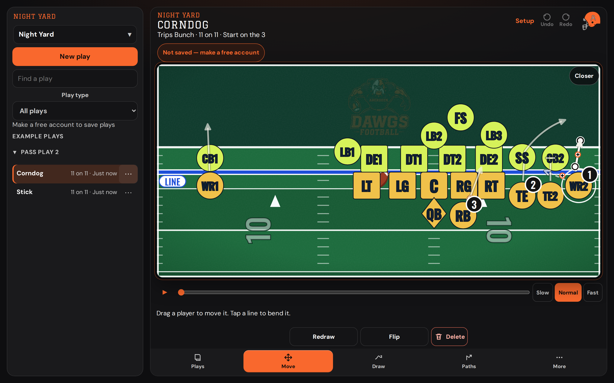
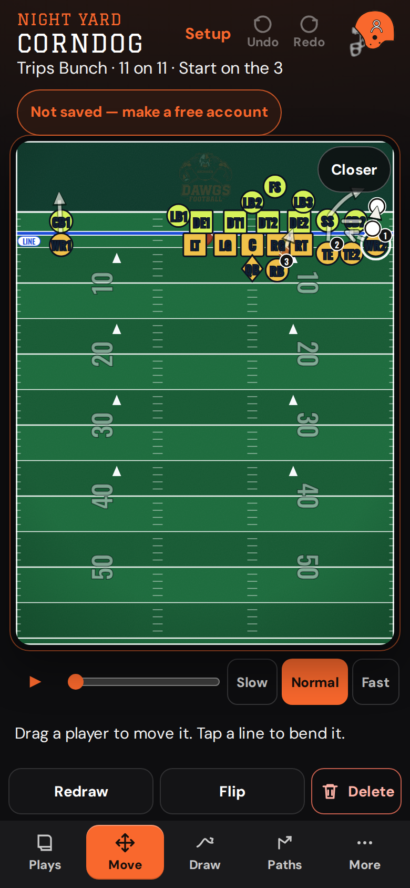
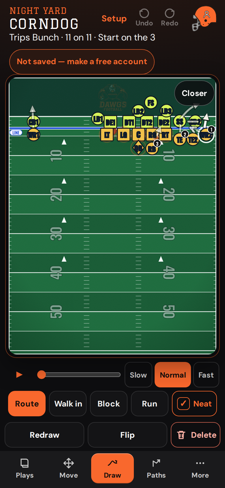
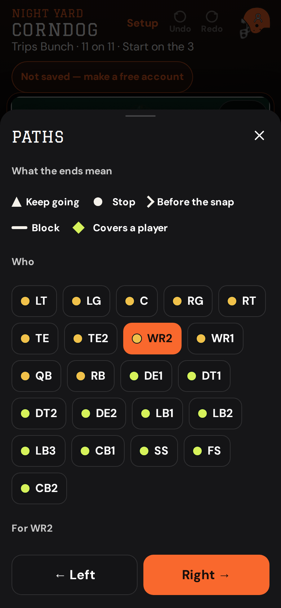
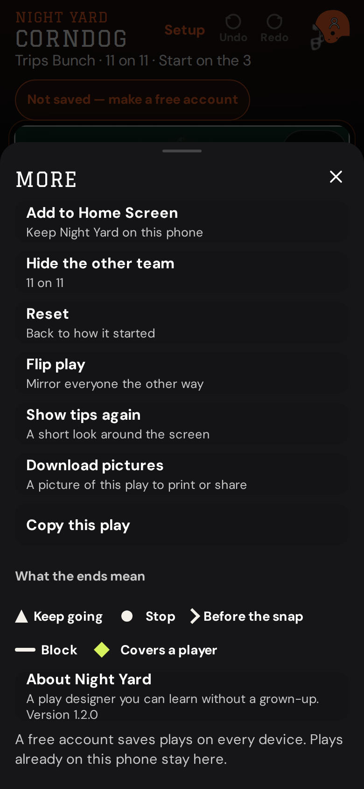

# Night Yard

**A free, open-source football play designer** for flag 5v5 through 9v9 and 11v11 tackle. Built so a kid can draw a play without help.



Play it live: **[https://www.roninforged.com/nightyard/](https://www.roninforged.com/nightyard/)**

| | |
|---|---|
| **Who it is for** | Kids, parents, and coaches |
| **Formats** | Flag 5v5, 6v6, 7v7, 8v8, 9v9, and 11v11 tackle |
| **License** | MIT ([LICENSE](LICENSE)) |
| **Runs in** | A phone, tablet, or computer browser |
| **Account** | Optional. Try it first. |

---

## What you get

- **Draw routes** with your finger or a mouse. The line tidies itself as you go.
- **Neat lines** straighten a wobbly drag when it is almost straight.
- **Move players**, flip a route, and delete it with Undo.
- **Ready paths** such as Go, Slant, Out, Curl, and Block for linemen.
- **Defense** jobs: zones, man coverage, and a rush.
- **Playback** at Slow, Normal, or Fast.
- **Save** on this phone, or make a free account and open the same plays on another device.
- **Pictures** to print or share: color or white, one play or a whole playbook PDF.
- **Home screen** so Night Yard opens like a game.

---

## Draw your first play in 60 seconds

1. Open [Night Yard](https://www.roninforged.com/nightyard/).
2. Tap **Try it first**.
3. Tap **Skip** if a short tip pops up.
4. Tap **Draw** at the bottom.
5. Put your finger on an orange player and drag. Lift your finger. That line is a route.
6. Tap the orange play button to watch it.

That is the whole idea. The rest of the buttons are there when you want them.

---

## A look around

**On a phone.** The field, the play button, and Move, Draw, Paths, and More.



**Draw.** Route, Walk in, Block, and Run pick the kind of line. Neat straightens it. Redraw, Flip, and Delete show up after you draw.



**What the ends mean**

| End | It means |
|---|---|
| Arrow | Keep going |
| Dot | Stop |
| Chevron | Before the snap |
| Bar | Block |
| Diamond | Covers a player |

**Paths.** Tap a player, then tap a ready path. Left and Right flip which way it breaks.



**Move.** Drag a player to a new spot. Tap a line to bend it. On a full 11v11 field, tap **Closer** to see the players bigger. Left, Middle, and Right move that closer view. **Whole field** brings everyone back. You can also drag the empty grass to slide the view, or double-tap the field.

**Flip.** Flip one route from the button under the field. Flip the whole play from **More**. Both can be undone.

**Watch it.** Slow, Normal, and Fast sit next to the slider.

**Save and open again.** Plays stay on this phone. A free account keeps them when you use another phone. The chip at the top tells you if they are saved.

**Pictures.** **More**, then **Download pictures**. Color is for the screen. White is for paper. A playbook PDF puts several plays in one file. The footer says Night Yard and your playbook name.

**Home screen.** **More**, then **Add to Home Screen**. On an iPhone, Night Yard shows the taps. On Android, one tap installs it.



---

## Questions

**Does it cost money?**
No.

**Do I need an account?**
No. Tap **Try it first** and draw. An account is only for saving plays onto another device.

**Can I use it for flag and for tackle?**
Yes. Flag is 5v5 through 9v9. Tackle is 11v11. Flag plays do not have a Block path. Tackle does.

**The players are on top of each other.**
Tap **Closer**. Then Left, Middle, or Right, or drag the grass.

**I drew the wrong line.**
Tap **Delete**, or **Undo** at the top. Tap the Undo on the little message if you want the line back.

**Can I put it on my home screen?**
Yes. **More**, then **Add to Home Screen**.

---

## Run it on your computer

You need Node.js 22 or newer.

```bash
git clone https://github.com/siriusbontea/nightyard.git
cd nightyard
npm install
npm run dev
```

Open **http://127.0.0.1:43123**.

| Command | What it does |
|---|---|
| `npm run dev` | Run the app while you work on it |
| `npm test` | Run the unit tests |
| `npm run test:e2e` | Run the browser tests. Needs PocketBase on port 8090 |
| `npm run build` | Typecheck and build. Uses `/nightyard/` unless you set `BASE_PATH` |
| `npm run build:prod` | The live-site build, always at `/nightyard/` |

The live site is served from `/nightyard/`. A production build writes a static `dist/` folder. Stop `npm run dev` before `npm run preview` if you want to look at that folder on the same port.

---

## Accounts and PocketBase

Drawing does not need a server. A free account is optional. When you make one, plays sync through PocketBase. In development the app talks to it at `/nightyard/pb`, which the dev server forwards to `127.0.0.1:8090`. See [server/README.md](server/README.md) for how to start PocketBase and what it stores. Set `VITE_POCKETBASE_URL` if it lives somewhere else.

---

## Credits

Made by Sirius Bontea.

Thanks to Bear for testing and ideas, including the flip feature.
